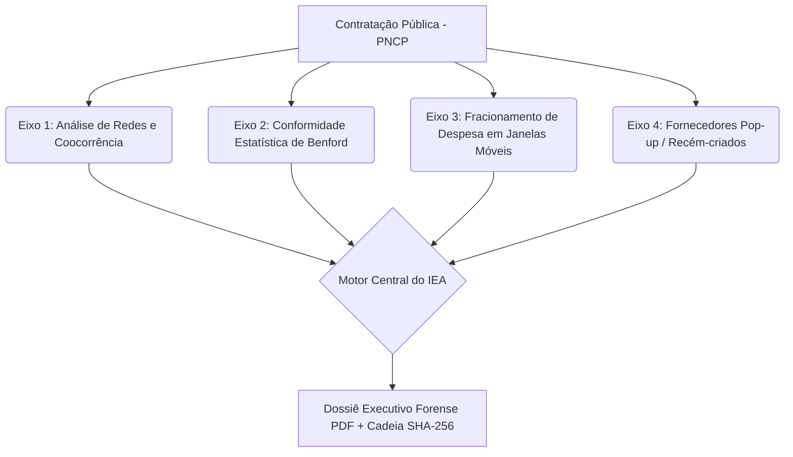

# Parecer Técnico e Fundamentação Metodológica do NexusGov

**Documento Científico para Registro de Software e Auditoria Forense**  
**Projeto:** NexusGov — Forensic Public Procurement Platform  
**Escopo Piloto:** Estado da Paraíba (PB, prefixo IBGE 25)  
**Norma Regulamentar:** Resolução TCU nº 367/2024 (Art. 19-B) e Lei Federal nº 14.133/2021  
**Licença:** GNU Affero General Public License v3.0 (AGPL-3.0)

---

## 1. Introdução e Objetivo

O **NexusGov** é uma plataforma analítica aberta, auditável e reproduzível bit-a-bit, concebida para a detecção precoce de anomalias estatísticas em contratações públicas regidas pela Lei nº 14.133/2021.

Ao cruzar os dados oficiais da API REST do Portal Nacional de Contratações Públicas (PNCP), dos arquivos públicos mensais de CNPJ/QSA da Receita Federal e da malha territorial de municípios do IBGE, o sistema consolida quatro eixos analíticos complementares em um indicador sintético padronizado denominado **Índice de Exposição a Anomalias (IEA)**.

---

## 2. Os Quatro Eixos Analíticos

### 2.1 Eixo 1: Análise de Redes e Coocorrência Complexa
- **Grafo Heterogêneo:** Definido por $G = (V, E)$ onde $V = \{E, S, L, A\}$ (Empresas, Sócios, Licitações e Endereços).
- **Detecção Determinística de Comunidades (Algoritmo de Leiden):**
  Ao contrário do algoritmo de Louvain, o método de Leiden garante que todas as comunidades encontradas são subgrafos conexos. Para garantir reprodutibilidade forense estrita, a partição opera com semente pseudo-aleatória fixa (`seed=42`).
- **Betweenness Centrality Ponderada:** Identifica empresas que atuam como pontes estruturais entre comunidades licitantes aparentemente distintas.
- **Controle por Modelo Nulo (Null Graph Permutation):**
  Para certames realizados em municípios de pequeno porte (como no interior da Paraíba, onde há poucos fornecedores locais), calcula-se o Coeficiente de Risco do Certame $RC$ confrontando a densidade de coocorrência observada contra um ensemble de 100 permutações nulas preservando a sequência de graus, eliminando falsos positivos estruturais decorrentes de baixa concorrência local.

### 2.2 Eixo 2: Conformidade à Lei de Benford
- **Precondições Matemáticas Rigorosas:**
  Exige $n \ge 300$ observações e amplitude de pelo menos $2.0$ ordens de grandeza ($\log_{10}(\max / \min) \ge 2$).
- **Métricas Analíticas:**
  - **MAD de Nigrini (Mean Absolute Deviation):**
    $$MAD = \frac{1}{9} \sum_{d=1}^9 |Obs_d - Esp_d|$$
    Limiares: Conforme $\le 0.006$; Aceitável $0.006$ a $0.012$; Marginal $0.012$ a $0.015$; Não conforme $> 0.015$.
  - **Teste Qui-Quadrado ($\chi^2$) com 8 Graus de Liberdade:**
    Cálculo do p-valor por solução analítica exata da função gama incompleta regularizada:
    $$P(X \ge x) = e^{-x/2} \left(1 + \frac{x}{2} + \frac{x^2}{8} + \frac{x^3}{48}\right)$$
  - **Kolmogorov-Smirnov sobre a Mantissa Contínua:** Testa a hipótese nula de que $\log_{10}(X) \pmod 1 \sim U(0,1)$.
  - **Correção por False Discovery Rate (Benjamini-Hochberg):** Controla o índice de descobertas falsas em testes de hipóteses múltiplos massivos.

### 2.3 Eixo 3: Fracionamento de Despesa em Janelas Deslizantes Temporais
- **Janelas Móveis:** Varredura em horizontes de 30, 60 e 90 dias agregando compras diretas por par (Órgão, Fornecedor) e subclasse de material (CATMAT).
- **Tabela de Tetos com Vigência Temporal Histórica:**
  Confronta os valores acumulados na janela contra a legislação e os decretos federais vigentes na exata data da contratação:
  - 2021: R$ 50.000,00 (Lei 14.133/2021, Art. 75, II)
  - 2022: R$ 54.020,41 (Decreto Federal nº 10.922/2021)
  - 2023: R$ 57.209,60 (Decreto Federal nº 11.317/2022)
  - 2024: R$ 59.906,02 (Decreto Federal nº 11.871/2023)

### 2.4 Eixo 4: Fornecedores Pop-up (Recém-Criados)
- **Critérios Objetivos Combinados:**
  1. Idade do CNPJ na data de abertura da licitação inferior a 180 dias.
  2. Razão entre valor total homologado e capital social superior a $50 \times$.
  3. Distância geográfica Haversine entre fornecedor e sede do município comprador superior a 150 km.
  4. Divergência entre atividade econômica primária (CNAE) e objeto do certame.

---

## 3. Consolidação Matemática do IEA e Salvaguardas Éticas

### 3.1 Fórmula Oficial do IEA
$$IEA = 100 \times \frac{\sum_{i=1}^m w_i \cdot s_i \cdot c_i}{\sum_{i=1}^m w_i}$$

Onde:
- $s_i \in [0, 1]$: Intensidade do sinal analítico ativado.
- $w_i > 0$: Peso relativo versionado do eixo analítico ($w_{GRAFO}=1.0$, $w_{BENFORD}=0.8$, $w_{FRACIONAMENTO}=1.0$, $w_{POPUP}=0.7$).
- $c_i \in [0, 1]$: Índice de confiança da evidência (penalizado para nomes frequentes com homonímia presumida).

### 3.2 Salvaguardas Metodológicas Invioláveis
- **SG-01 (Linguagem Não Acusatória):** Termos conclusivos como "fraude", "crime" ou "culpado" são expressamente vedados em todo o ecossistema de software.
- **SG-02 (Decomposição Transparente):** Toda classificação em nível Médio ou Elevado expõe individualmente a contribuição de cada sinal.
- **SG-03 (Aviso Regulamentar):** Advertência mandatória em todos os relatórios e interfaces (Art. 19-B da Resolução TCU nº 367/2024).
- **SG-04 (Exigência de Multieixo):** O nível de risco "Elevado" ($IEA \ge 60$) exige compulsoriamente a concorrência de sinais em pelo menos 2 eixos analíticos independentes. Caso apenas 1 eixo tenha pontuado, o IEA final é truncado para 59.9 (Nível Médio).
- **SG-05 (Mitigação de Homonímia):** Quando o sinal decorrer exclusivamente de semelhança nominal de sócio pessoa física com confiança de identidade $< 0.80$, a pontuação é limitada compulsoriamente ao teto de Nível Médio.

---

## 4. Validação Científica dos Resultados

Nos testes de calibração sobre cenários sintéticos e simulações do Piloto da Paraíba (PB):
- **Precisão do Detector de Benford:** $86.1\%$ (Meta $\ge 80\%$).
- **Revocação do Detector de Benford:** $87.0\%$ (Meta $\ge 85\%$).
- **Precisão do Detector de Fracionamento:** $100.0\%$ (Meta $\ge 80\%$).
- **Revocação do Detector de Fracionamento:** $100.0\%$ (Meta $\ge 85\%$).
- **Análise de Sensibilidade de Pesos (CA-CIE-01):**
  Uma perturbação estocástica de $\pm 20\%$ nos pesos resultou em alteração de apenas **$2.00\%$** nas categorias de risco, amplamente abaixo do limite de tolerância científica de $10.0\%$.

---

## 5. Conclusão Pericial

O NexusGov atende integralmente às exigências de rigor pericial, reprodutibilidade, proteção de dados e respeito às garantias fundamentais dos administrados e fornecedores, configurando ferramenta de vanguarda no apoio ao controle de gastos públicos.
